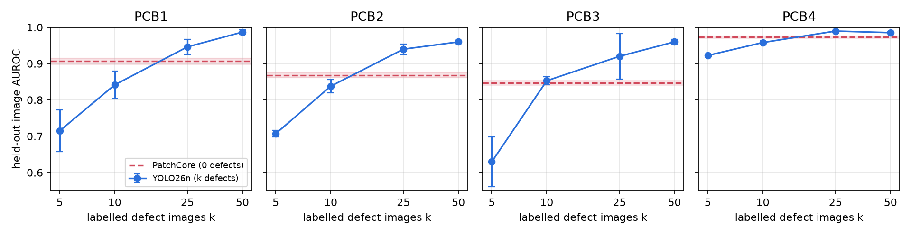

# PCB defect detection: when does a supervised detector overtake PatchCore?

PatchCore learns from normal images only. YOLO26 needs labelled defects. On the four PCB categories of
[VisA](https://github.com/amazon-science/spot-diff), this repo measures how many labelled defect images YOLO26n
needs to beat PatchCore, and what each loses when quantized to INT8 for CPU inference.

The plan was written before any run: [DESIGN.md](DESIGN.md). Every later change is in its change log.
Full write-up (Chinese): [report/report.md](report/report.md).

## Result



Held-out image AUROC, mean ± std over 3 seeds (50 held-out defects + 100/101 normals per category):

| | PatchCore (0 defects) | YOLO26n k=5 | k=10 | k=25 | k=50 |
|---|---|---|---|---|---|
| PCB1 | 0.906 ± 0.009 | 0.715 ± 0.057 | 0.841 ± 0.038 | 0.946 ± 0.021 | 0.987 ± 0.006 |
| PCB2 | 0.868 ± 0.007 | 0.707 ± 0.009 | 0.838 ± 0.018 | 0.940 ± 0.014 | 0.960 ± 0.005 |
| PCB3 | 0.847 ± 0.006 | 0.630 ± 0.069 | 0.853 ± 0.011 | 0.920 ± 0.063 | 0.960 ± 0.007 |
| PCB4 | 0.973 ± 0.003 | 0.922 ± 0.004 | 0.958 ± 0.005 | 0.990 ± 0.002 | 0.985 ± 0.002 |

- The crossover lies between 10 and 25 labelled defects in every category. At k = 25 YOLO26n wins all four.
- With few defects PatchCore is better and far more stable (std ≤ 0.01 vs up to 0.07).

CPU deployment (OpenVINO, NNCF post-training INT8, i5-12400, batch 1, network only, PCB1 latency):

| | mean AUROC (4 cats) | IR size | 1 thread | 6 threads |
|---|---|---|---|---|
| YOLO26n FP32 | 0.977 | 9.2 MB | 69.7 ms | 24.2 ms |
| YOLO26n INT8 | 0.974 | 2.4 MB | 33.2 ms | 12.1 ms |
| PatchCore FP32 | 0.897 | 215 MB | 869 ms | 233 ms |
| PatchCore INT8 | 0.869 | 174 MB | 730 ms | 190 ms |
| PatchCore INT8, backbone only (post-hoc) | 0.877 | 144 MB | 739 ms | 190 ms |

INT8 halves YOLO26n latency for at most 0.005 AUROC. PatchCore gains about 1.2× because its time goes to the
nearest-neighbour search over a 20,480-patch memory bank, and it loses up to 0.05 AUROC.

## Setup

- PatchCore: anomalib 2.7 defaults (WideResNet-50 layer2+3, coreset 10%, 256 px), fitted on 200 normal images.
- YOLO26n: ultralytics 8.4, COCO-pretrained, defaults, 640 px, 100 epochs. Its training set is k defects (boxes
  from mask connected components) plus the same 200 normal images as background.
- Image score: PatchCore anomaly score; YOLO max box confidence. No hyperparameter was tuned on the held-out set.

## Reproduce

```bash
uv sync
# download VisA (CC BY 4.0) and extract to datasets/visa_raw/
./scripts/run_all.sh            # split, PatchCore 4x3, YOLO 4x4x3, evaluate  (~3 h on an RTX 3060)
uv run python -m dd.deploy      # OpenVINO FP32 / INT8
uv run python scripts/make_figs.py
```

`runs/patchcore/` and `runs/yolo/` hold every per-image score, so `uv run python -m dd.evaluate` recomputes all
accuracy numbers without retraining. Datasets, weights and exported models are not committed.

## Workarounds for anomalib 2.7 export

`dd/deploy.py` avoids three problems found while exporting PatchCore:

1. The exporter bakes a batch of 2 into the resize nodes, so the IR fails on single images. Fixed by exporting
   a static batch-1 graph.
2. `INT8_PTQ` calibrates on the val loader, which here is the held-out test set. Fixed by calling
   `nncf.quantize` with the 200 normal training images.
3. `OpenVINOInferencer` returned wrong scores after its first call. Fixed by using a compiled model directly.
   The FP32 IR then matches PyTorch's AUROC.

## Limits

One dataset (VisA PCB1–4); image-level metrics only; both methods downsample ~1,000×1,400 images. PatchCore uses
200 normals because of 12 GB GPU memory. With all ~900 it might be stronger and the crossover could move later.

Data: VisA, CC BY 4.0, Amazon.
