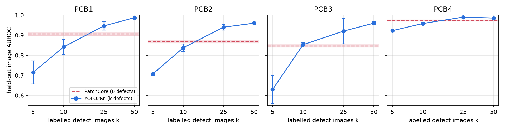

# PCB 瑕疵偵測：PatchCore 和 YOLO26 什麼時候交叉

問題：PatchCore 只看正常品就能做 anomaly detection；YOLO26 是監督式 detector，需要標註過的瑕疵圖。在 PCB 影像上，YOLO 要多少張標註瑕疵才能贏過 PatchCore？兩者量化成 INT8 放到 CPU 上之後，又各自掉多少？

資料：VisA 的 PCB1–PCB4（CC BY 4.0）。
硬體：RTX 3060 12 GB、Intel Core i5-12400、WSL2。
軟體：PyTorch 2.15、anomalib 2.7.0、ultralytics 8.4.207、OpenVINO 2026.4、NNCF 3.4，以 uv 管理。
實驗設計在跑之前寫在 [DESIGN.md](../DESIGN.md)，後來的修改都記在它的 change log。

## 0. 實驗規則

| split | 每類張數 | 用途 |
|---|---|---|
| normal train | 約 900，每個 seed 抽 200 | PatchCore 的 memory bank；YOLO 的背景圖（同一批） |
| defect pool | 50 | YOLO 從這裡抽 k 張瑕疵當訓練資料 |
| held-out | 50 瑕疵 + 100/101 正常 | 只用來評估，兩個方法完全相同 |

- 官方 `1cls` split 的 test 瑕疵用 seed 0 對半切成 pool 和 held-out，只切一次。
- PatchCore：anomalib 預設（WideResNet-50 layer2+3、coreset 10%、256 px），從沒看過瑕疵。
- YOLO26n：COCO pretrained、預設超參數、640 px、100 epochs、單一類別。box 取 VisA mask 的 connected components。用最後一個 epoch 的權重，沒有 val split，因為 k = 5 時切 val 會拿走訓練瑕疵。
- 影像分數：PatchCore 用它的 anomaly score；YOLO 用最大的 box confidence（沒有 box 就是 0）。指標是 image-level AUROC / AP。
- k ∈ {5, 10, 25, 50}，每個設定 3 個 seed（0/1/2），報 mean ± std。seed 同時決定抽哪 k 張瑕疵和哪 200 張正常圖。
- 沒有任何超參數在 held-out 上調過。

一開始 PatchCore 用全部約 900 張正常圖，memory bank 在 12 GB 顯卡上爆掉。在看到任何結果之前，改成兩個方法共用同一批 200 張。

## 1. 交叉點

held-out image AUROC（mean ± std，3 seeds）：

| | PatchCore（0 張瑕疵） | YOLO k=5 | k=10 | k=25 | k=50 |
|---|---|---|---|---|---|
| PCB1 | 0.906 ± 0.009 | 0.715 ± 0.057 | 0.841 ± 0.038 | 0.946 ± 0.021 | 0.987 ± 0.006 |
| PCB2 | 0.868 ± 0.007 | 0.707 ± 0.009 | 0.838 ± 0.018 | 0.940 ± 0.014 | 0.960 ± 0.005 |
| PCB3 | 0.847 ± 0.006 | 0.630 ± 0.069 | 0.853 ± 0.011 | 0.920 ± 0.063 | 0.960 ± 0.007 |
| PCB4 | 0.973 ± 0.003 | 0.922 ± 0.004 | 0.958 ± 0.005 | 0.990 ± 0.002 | 0.985 ± 0.002 |
| 四類平均 | 0.898 | 0.743 | 0.872 | 0.949 | 0.973 |

四類平均 AP：PatchCore 0.820；YOLO k=5/10/25/50 為 0.666 / 0.838 / 0.933 / 0.961。

- 四類的交叉點都落在 k = 10 到 25 之間。k = 25 時 YOLO 在每一類都贏，k = 10 時只有 PCB3 打平（差 0.006，在 std 內）。
- AP 的交叉比 AUROC 早一點：k = 10 的平均 AP 已經略高於 PatchCore。PatchCore 在 PCB2 的 AP 只有 0.721，排在最前面的高分裡混了不少正常圖。
- k 小的時候 YOLO 很不穩。PCB3 在 k = 5 的 std 是 0.069，抽到哪 5 張影響很大。PatchCore 的 std 在每類都不超過 0.01。
- PCB4 比較容易，PatchCore 已經 0.973，YOLO 到 k = 25 才多 0.017。
- k = 50 已經把整個 pool 用完，三個 seed 用的是同一批瑕疵，這一欄的 std 只反映背景圖抽樣和訓練隨機性。

訓練時間（RTX 3060）：PatchCore 每類約 110–140 秒，peak GPU memory 2.4 GB；YOLO26n k = 50 約 225–275 秒。

## 2. INT8 部署（CPU）

設定：每類用 seed 0 的模型匯出 OpenVINO IR，INT8 用 NNCF post-training quantization。YOLO 是 k = 50 的模型。

- AUROC 在每一類的 held-out 上算。
- 延遲只在 PCB1 上量，因為四類的網路結構相同。量法是 batch 1，暖機 20 次後取 200 次的中位數。
- 輸入是已經縮好的圖（YOLO 640×640、PatchCore 256×256），所以量到的只有網路本身，不含讀檔和縮圖。

| | AUROC 平均（4 類） | IR 大小 | 1 thread | 6 threads |
|---|---|---|---|---|
| YOLO26n FP32 | 0.977 | 9.2 MB | 69.7 ms | 24.2 ms |
| YOLO26n INT8 | 0.974 | 2.4 MB | 33.2 ms | 12.1 ms |
| PatchCore FP32 | 0.897 | 215 MB | 869 ms | 233 ms |
| PatchCore INT8（NNCF 預設） | 0.869 | 174 MB | 730 ms | 190 ms |
| PatchCore INT8，只量化 backbone（post-hoc） | 0.877 | 144 MB | 739 ms | 190 ms |

各類 AUROC（FP32 → INT8 → INT8 backbone-only）：

| | YOLO26n | PatchCore |
|---|---|---|
| PCB1 | 0.990 → 0.985 | 0.897 → 0.848 → 0.872 |
| PCB2 | 0.963 → 0.961 | 0.874 → 0.822 → 0.823 |
| PCB3 | 0.964 → 0.962 | 0.847 → 0.853 → 0.857 |
| PCB4 | 0.991 → 0.990 | 0.971 → 0.954 → 0.955 |

- YOLO 量化後延遲約減半，大小剩約四分之一，AUROC 每類最多掉 0.005。
- PatchCore 量化幾乎沒有好處。延遲只快約 1.2×，因為時間主要花在 1,024 個 patch 對 20,480 筆 memory bank 的最近鄰搜尋，量化 backbone 省不了這段。AUROC 在 PCB1、PCB2 掉了約 0.05，PCB3 反而微升。
- 只量化 backbone 這組是看到 PCB1 掉分之後才加的（post-hoc）。它在 PCB1 救回一半，在其他類別和全量化差不多，所以掉分主要來自 backbone 特徵本身的量化誤差，不是距離計算。
- IR 大小：PatchCore 有約 120 MB 是 FP32 的 memory bank（20,480 × 1,536）。
- 在 FP32 下，OpenVINO 和 PyTorch 的 AUROC 差距在 0.005 以內（PatchCore 幾乎完全一致）。YOLO 的小差異來自 GPU 換成 CPU，以及前處理的 letterbox 不同。

部署時踩到的 anomalib 問題（都已繞過，細節在 `dd/deploy.py` 的註解）：

1. 匯出時 batch = 2 被寫死在 resize 節點裡，改成匯出靜態的 batch-1 graph。
2. `INT8_PTQ` 拿 val loader 做校正，而這裡的 val loader 就是 held-out 測試集。改成直接呼叫 `nncf.quantize`，只用 200 張正常訓練圖校正。
3. `OpenVINOInferencer` 只有第一次呼叫的分數正確，改用 `compile_model` 直接推論。

## 3. 結論

1. 在 VisA PCB 上，每類大約 10 到 25 張標註瑕疵，YOLO26n 就能贏過 PatchCore；到 25 張時四類全贏。
2. 瑕疵圖很少（約 10 張以下）時，PatchCore 比較好，而且穩定很多。
3. 要上 CPU 的話，YOLO26n 比 PatchCore 輕很多：FP32 下 IR 小約 23 倍、6 threads 延遲快約 10 倍，INT8 之後差距更大。PatchCore 的成本卡在 memory bank 搜尋，量化幫不上忙。
4. 實務上的順序：產線剛開始、瑕疵圖很少時先用 PatchCore；累積到每類幾十張標註後改用 YOLO。

## 4. 限制

- 只有 VisA 的四個 PCB 類別，一個資料集。
- 兩個方法都會縮圖（PatchCore 到 256 px、YOLO 到 640 px），原圖約 1,000 × 1,400 px，很小的瑕疵可能在縮圖後消失。兩邊都用 library 預設，沒有調解析度。
- 只比 image-level 指標，沒有比定位品質。
- PatchCore 只用 200 張正常圖，是受 12 GB 顯卡限制。用全部約 900 張的話，PatchCore 可能更強，交叉點可能往後移。
- held-out 每類只有 50 張瑕疵，AUROC 的 0.01 級差異不該過度解讀。
- 延遲只在一顆 i5-12400 上量過。
